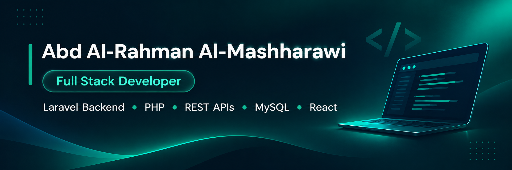

  

  <h2>Abd Al-Rahman Al-Mashharawi</h2>
  
<strong>Full Stack Web Developer | Laravel Backend Developer</strong>

  
Gaza, Palestine &nbsp;·&nbsp; PHP / Laravel &nbsp;·&nbsp; REST APIs &nbsp;·&nbsp; MySQL &nbsp;·&nbsp; React

  

    <a href="https://github.com/abood-basheer">GitHub Profile</a>
    &nbsp;·&nbsp;
    Open to Backend and Full Stack opportunities
  

---

## About Me

I'm a **Full Stack Web Developer** specializing in **PHP and Laravel**, with practical experience developing web platforms, designing relational databases, building RESTful APIs, and integrating services across different technologies.

I study **Intelligent Systems and Computer Engineering at Al-Aqsa University**. Through my CodeMap training, freelance experience, and collaborative projects, I've learned to take features from requirements to implementation, testing, and delivery.

I care about maintainable code, clear communication, and building products that solve real problems.

## Technical Expertise

| Area | Technologies and Skills |
| --- | --- |
| **Backend** | PHP, Laravel, RESTful APIs, authentication and authorization, API integrations |
| **Frontend** | HTML, CSS, JavaScript, React, Bootstrap |
| **Database** | MySQL, relational database design, migrations |
| **Development Tools** | Git, GitHub, Postman, VS Code, XAMPP, Figma |
| **Practices** | Feature branches, pull requests, automated testing, debugging, teamwork |

## Featured Projects

### Hirafy — Craftspeople Services Marketplace

**Full Stack Developer | Independently built the website from scratch**

Hirafy is a web platform that helps customers find craftspeople and view their services and previous work.

- Designed the database and developed the application using **Laravel and MySQL**.
- Built frontend pages and connected them to backend features.
- Implemented account management, an administration dashboard, and craftspeople profiles with project galleries.
- Handled feature improvements, troubleshooting, and end-to-end application behavior.

**Stack:** PHP, Laravel, MySQL, HTML, CSS, JavaScript, Bootstrap

### Tilqaa — Opportunity and Talent Platform

**Backend Developer | Collaborative team project**

Tilqaa is a platform that connects job and opportunity seekers with organizations and supports skills-based discovery and applications.

- Developed and maintained Laravel REST API features.
- Worked on **Google Sign-In** and seeker **portfolio functionality**.
- Implemented **matching-score logic** to evaluate alignment between candidates and opportunities.
- Contributed to Laravel integration with an AI assistant service, including API handling and testing.
- Collaborated through Git branches, pull requests, and automated tests.

**Stack:** Laravel, MySQL, REST APIs, Git, GitHub, automated testing

*The team backend repository is private; this section describes my contributions without exposing proprietary code.*

### SmartVI — AI-Powered Vehicle Damage Inspection

**Laravel Backend Developer | Graduation project (in progress)**

SmartVI is a mobile application project designed to support vehicle damage inspection using AI models.

- Responsible for the **Laravel backend** and public API layer.
- Working on the integration between the **Flutter mobile app** and the **Python/FastAPI AI service**.
- Collaborating with teammates responsible for mobile development and AI.

**Stack:** Laravel, REST APIs, Flutter integration, FastAPI integration

## How I Work

- Translate project requirements into clear backend features and database structures.
- Develop and test APIs with attention to validation, authorization, and error handling.
- Use Git-based workflows to coordinate changes and review work within a team.
- Investigate bugs, improve existing features, and learn tools as each project requires.

## Professional Focus

I'm working toward a **Backend or Full Stack Developer** position where I can contribute to production projects, strengthen my system design and deployment skills, and continue growing within a professional engineering team.

---

  <strong>Interested in collaborating?</strong> 
  Explore my work and connect with me through <a href="https://github.com/abood-basheer">GitHub</a>.

